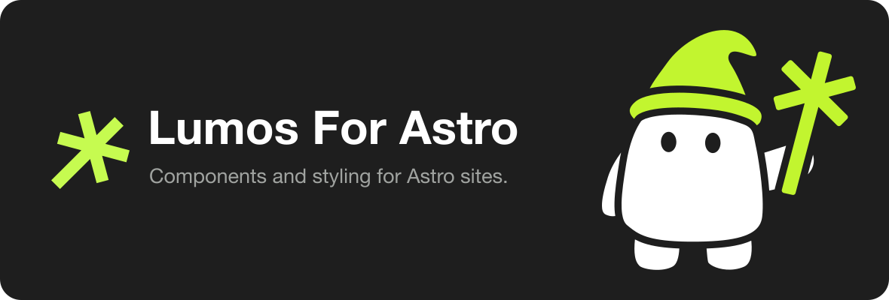

<p align="center">
  
</p>

<p align="center">
  <a href="https://www.npmjs.com/package/create-lumos"></a>
  <a href="LICENSE"></a>
  <a href="https://github.com/lumosframework/lumos-for-astro/actions/workflows/ci.yml"></a>
</p>

A component and styling framework for building Astro sites, designed around
efficiency, scalability and accessibility.

Documentation lives at **[lumosframework.com](https://lumosframework.com)**.

## Getting started

```sh
npm create lumos@latest my-site
```

That scaffolds a new site from this repository and installs its dependencies
with whichever package manager you ran it with. Then:

```sh
cd my-site
npm run dev
```

| Script            | What it does                      |
| ----------------- | --------------------------------- |
| `npm run dev`     | Starts the dev server             |
| `npm run build`   | Builds the site to `dist/`        |
| `npm run preview` | Serves the built site             |
| `npm run check`   | Type-checks every `.astro` file   |
| `npm run format`  | Formats the project with Prettier |

Node 22.22 or newer is required.

## Documentation

Component reference, styling guides and examples are at
[lumosframework.com](https://lumosframework.com).

## License

[MIT](LICENSE)
